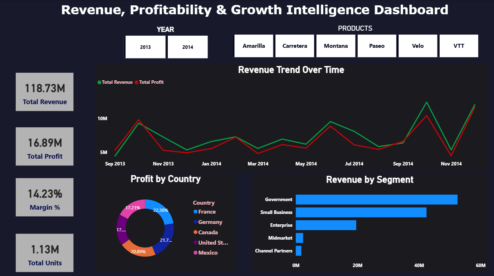

# CFO Dashboard

## Project overview

A Power BI executive finance dashboard built to compare revenue, profit, profit margin, and units across time, customer segments, countries, and products. Its report layout includes KPI cards, a revenue/profit trend, revenue by segment, profit by country, and year/product slicers.

## Data

The accompanying `Financials.csv` contains **700 rows** spanning **2013–2014**, with sales, gross sales, discounts, cost of goods sold, profit, units sold, segment, country, product, and date fields. The supplied CSV has no missing values. Currency-formatted fields were cleaned of dollar signs and spaces for the calculations below.

## Findings from the supplied data

- Net sales total approximately **$118.73 million**, with gross sales of **$127.93 million** and discounts of **$9.21 million**.
- Recorded profit totals approximately **$17.67 million**, an overall margin of about **14.9%** of net sales.
- Government is the largest segment by both sales (**$52.50 million**) and profit (**$11.39 million**). Small Business contributes **$42.43 million** in sales and **$4.14 million** in profit.
- Enterprise records **$19.61 million** in sales but only about **$162,776** in profit, a much thinner margin than the other segments.
- Sales are concentrated in the Government and Small Business segments, which together contribute about 80% of total net sales.

## Portfolio summary

Created an executive finance view of sales, margins, and profitability by time, segment, and country. The strongest finding is the contrast between Government's scale and profit contribution and Enterprise's substantial sales paired with a very thin recorded profit margin.

## Reproducibility note

Metrics above are computed from the adjacent CSV and rounded to two decimals. The `.pbix` report layout was readable and its visual fields support the views described. The source uses currency values but does not identify the currency explicitly.

